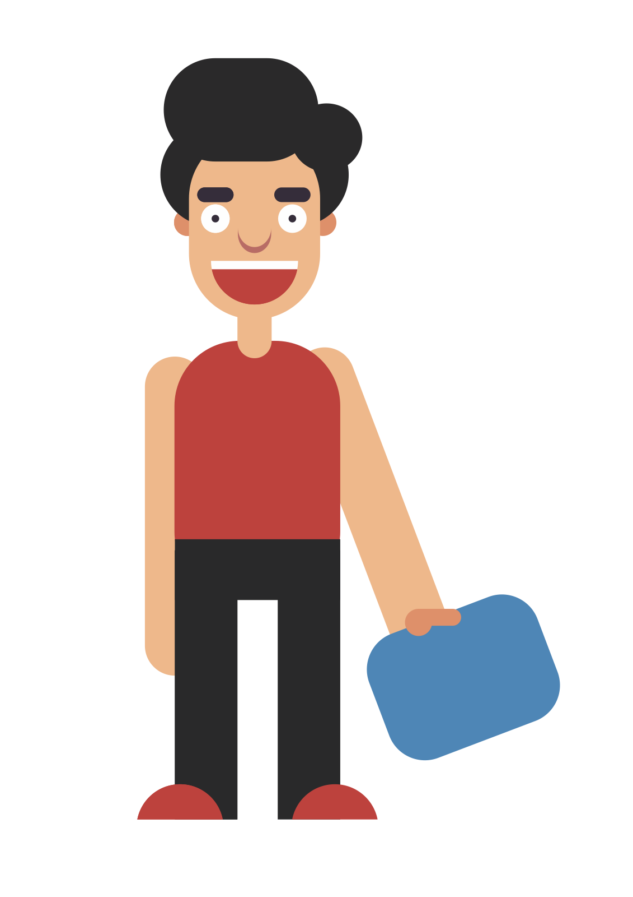
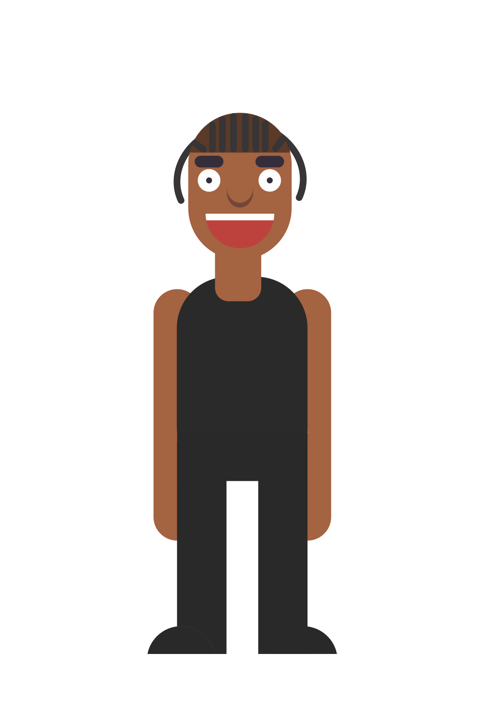
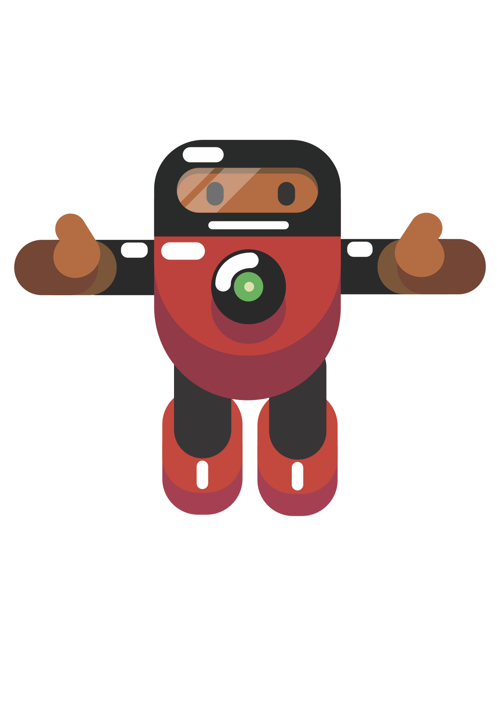

# Cartoon Set

Three flat vector characters drawn in Adobe Illustrator. The source files are the `.ai` documents in the repository root; the PNGs in `previews/` are rendered from them so the work can be seen on GitHub without opening Illustrator.

## The characters

| Cartoon 1 | Cartoon 2 | Cartoon 3 |
|---|---|---|
|  |  |  |

- **Cartoon 1** (`Cartoon1.ai`): a standing man with dark curly hair and a wide open smile, in a red sleeveless top, black trousers and red shoes, holding a blue case in one hand.
- **Cartoon 2** (`Cartoon2.ai`): a standing man with braided hair and the same wide smile, dressed in black from top to shoes, arms at his sides.
- **Cartoon 3** (`Cartoon3.ai`): a rounder, robot-like figure with a black helmet and visor, a red body with a round green lens on the chest, and arms spread wide.

All three share the same flat style: simple geometric shapes, no outlines, and a small palette of red, black, blue and skin tones on a white page.

## Opening and editing

- **Adobe Illustrator:** open any `CartoonN.ai` file directly. The layers and paths are fully editable.
- **Without Illustrator:** the files are saved with PDF compatibility, so a PDF viewer (Preview on macOS, a browser) can display them. Inkscape and Affinity Designer can import them for editing, though some Illustrator-specific features may not carry over.
- **Re-rendering the previews on macOS:**

  ```sh
  cp Cartoon1.ai /tmp/cartoon1.pdf
  qlmanage -t -s 1600 -o /tmp /tmp/cartoon1.pdf
  sips -s format png -Z 1600 /tmp/cartoon1.pdf.png --out previews/cartoon1.png
  ```

## License

Released under the MIT License. See [LICENSE](LICENSE).
